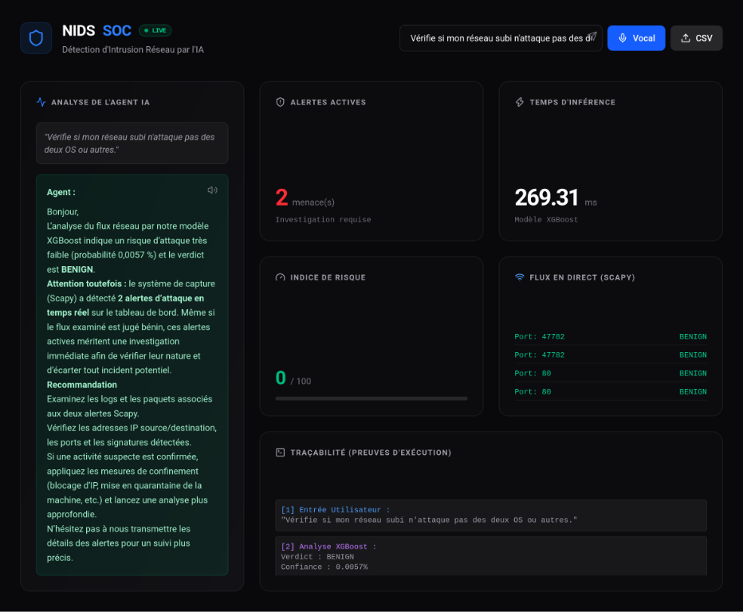
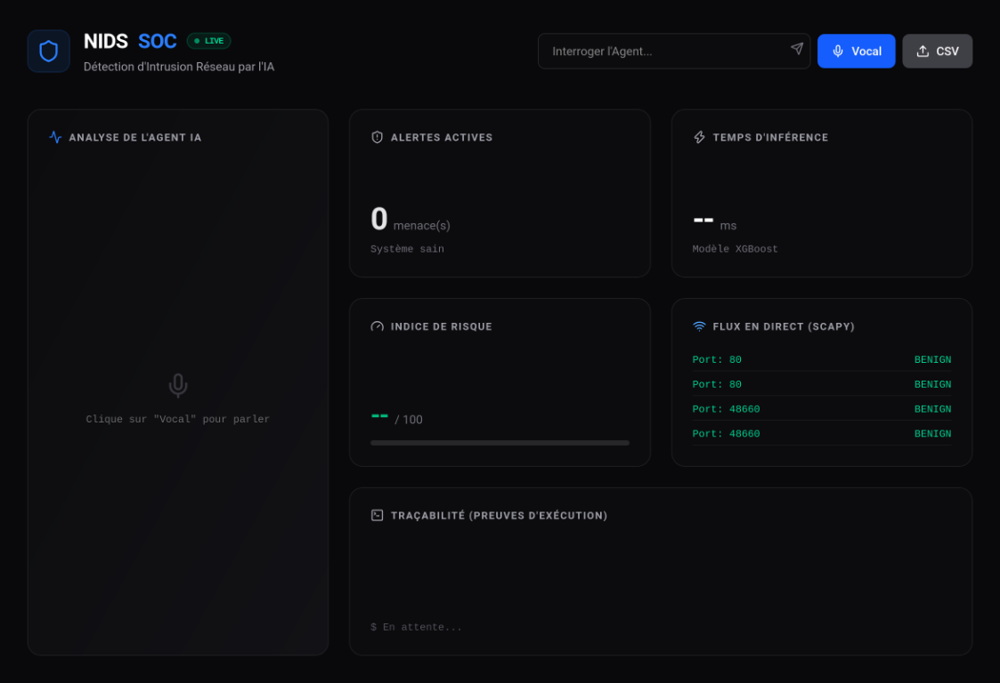
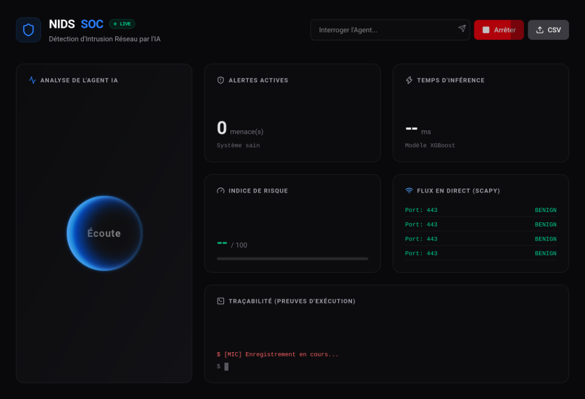
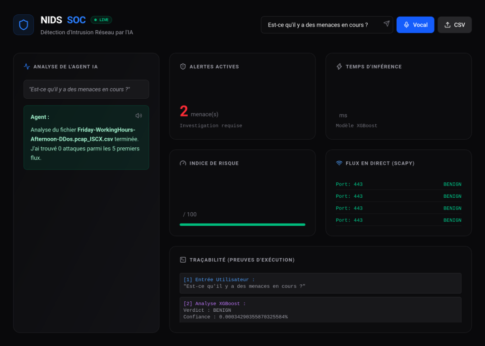
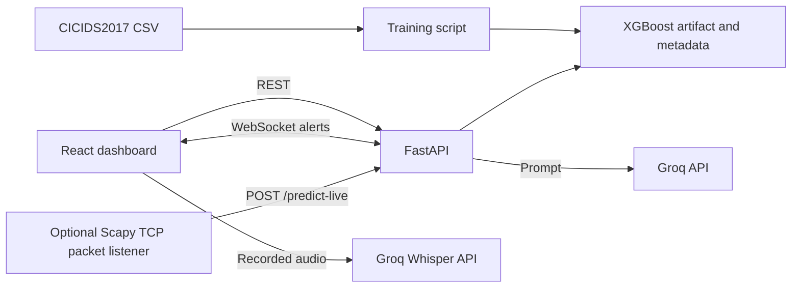

<div align="center">

# NIDS CICIDS2017

**A research prototype for network-flow classification and SOC analyst assistance.**

[](https://python.org)
[](https://fastapi.tiangolo.com)
[](https://react.dev)
[](https://typescriptlang.org)
[](https://xgboost.readthedocs.io)

</div>

---

## What it does

This project combines a FastAPI service, an XGBoost binary classifier, and a React dashboard. Analysts can submit a text question, record a French voice question, or upload a CICIDS-style CSV for a small random sample of rows to be classified. The dashboard also receives live predictions from an optional Scapy packet listener over a WebSocket.

The AI assistant and speech transcription use the **Groq-hosted API**. They are not local Ollama services: prompts, flow summaries, and uploaded audio sent to these features are processed by Groq.

## Dashboard

<p align="center">
  
</p>

| State | Screenshot |
|---|---|
| Dashboard idle with live feed |  |
| Voice recording |  |
| AI response with live-alert context |  |
| CSV analysis and execution trace |  |

## Architecture and implemented features



- **Classification:** the runtime pipeline loads `ml/models/xgb_nids.joblib` and `ml/models/metadata.json`, aligns incoming numeric features to the model's training feature list, fills missing features with zero, and returns a binary verdict and probability. The decision threshold is read from model metadata.
- **Model training:** `ml/train_and_save_models.py` trains XGBoost and an Isolation Forest and writes both model files plus metadata. The current API prediction pipeline uses **XGBoost only**; the Isolation Forest artifact is not currently used for inference.
- **Agent:** `POST /api/v1/agent` combines an XGBoost result with a French-language prompt and sends it to Groq (`openai/gpt-oss-120b`). A positive `live_alerts` value is added to the prompt as live-alert context.
- **CSV:** `POST /api/v1/upload-csv` accepts a CSV, randomly samples up to five rows, converts numeric values, and classifies those rows. The dashboard displays the first sampled result and summarizes the sampled predictions; it does not analyze every row in the file.
- **Voice:** the browser records audio, the backend sends it to Groq Whisper (`whisper-large-v3`, French), and the dashboard submits the transcription to the agent. Speech output uses the browser's speech synthesis.
- **Live feed:** the optional Scapy listener sends a small set of packet-derived TCP features to the API. This is a packet-level approximation, not complete CICIDS flow reconstruction. The API pushes each prediction to connected dashboard clients over WebSocket.
- **Parquet utility:** `ml/data/parquet.py` converts CICIDS CSV files to Parquet in bounded-memory batches.

## API

The FastAPI interactive documentation is available at `http://127.0.0.1:8000/docs` when the backend is running.

| Method | Path | Purpose |
|---|---|---|
| `GET` | `/` | Welcome message |
| `GET` | `/health` | Basic health response |
| `POST` | `/api/v1/predict` | Classify a feature dictionary |
| `POST` | `/api/v1/agent` | Classify features and request a Groq-generated French response |
| `POST` | `/api/v1/upload-csv` | Classify up to five randomly selected CSV rows |
| `POST` | `/api/v1/transcribe` | Transcribe uploaded audio with Groq Whisper |
| `POST` | `/api/v1/predict-live` | Classify packet-derived features and publish the result |
| `WS` | `/api/v1/ws/alerts` | Receive live prediction messages |
| `GET` | `/api/v1/trigger-fake-alert` | Send a test alert to connected WebSocket clients |

Example classification request:

```bash
curl -X POST http://127.0.0.1:8000/api/v1/predict \
  -H "Content-Type: application/json" \
  -d '{"features":{"Destination Port":80,"Flow Duration":100,"Total Fwd Packets":5}}'
```

Upload a CSV:

```bash
curl -X POST http://127.0.0.1:8000/api/v1/upload-csv \
  -F "file=@path/to/flows.csv"
```

The agent request accepts `prompt`, `features`, and an optional `live_alerts` count (default `0`):

```json
{
  "prompt": "Y a-t-il une menace ?",
  "features": {
    "Destination Port": 80,
    "Flow Duration": 100,
    "Total Fwd Packets": 5
  },
  "live_alerts": 0
}
```

## Local setup

### Prerequisites

- Python 3.12
- Node.js 20 or newer and npm
- CICIDS2017 CSV data for training, unless generated model artifacts are supplied separately
- A Groq API key for the agent and voice transcription
- Linux and `sudo` only if you want to run the optional Scapy packet listener

### 1. Install Python dependencies and prepare model artifacts

The repository ignores `ml/data/raw/` and `ml/models/`; the dataset and trained model artifacts are not included in Git. Place CICIDS2017 CSV files under `ml/data/raw/`. The training script looks for files whose names contain `WorkingHours`, reads the first match it finds, and uses up to 100,000 rows.

```bash
python3.12 -m venv venv
source venv/bin/activate
pip install -r requirements.txt
python ml/train_and_save_models.py
```

The root requirements file includes the full local stack; `backend/requirements.txt` lists the backend runtime dependencies used by its Docker image. Training creates `ml/models/xgb_nids.joblib`, `ml/models/iso_forest_nids.joblib`, and `ml/models/metadata.json`. The backend needs the XGBoost artifact and metadata to start.

### 2. Configure Groq

Create `backend/.env` and add your key:

```dotenv
GROQ_API_KEY=your_groq_api_key
```

Do not commit this file. The agent and transcription endpoints rely on this key.

### 3. Start the backend and frontend

Run the backend from the `backend/` directory:

```bash
cd backend
../venv/bin/uvicorn app.main:app --reload --host 127.0.0.1 --port 8000
```

In another terminal, install and start the frontend:

```bash
cd frontend
npm ci
npm run dev
```

Open the Vite URL shown in the terminal (normally `http://localhost:5173`). The frontend currently calls the backend at `127.0.0.1:8000` directly.

### 4. Optional live packet capture

The listener is in `backend/app/ml/live_capture.py`. Before running it, update its hard-coded network interface (`wlp2s0`) to an interface on your machine. From the repository root:

```bash
sudo venv/bin/python -m backend.app.ml.live_capture
```

Packet capture requires elevated privileges. Use it only on a network you are authorized to monitor.

## Data preparation and training

The training script reads CICIDS2017 CSV files from `ml/data/raw/`, cleans column names and labels, removes rows with missing or infinite values, and maps `BENIGN` to class `0` and all other labels to class `1`. It trains an XGBoost classifier and an Isolation Forest on benign training rows, then writes model artifacts and metadata to the ignored `ml/models/` directory.

Convert a directory of raw CSV files to Parquet with:

```bash
python -m ml.data.parquet \
  --source ml/data/raw \
  --destination ml/data/processed/parquet
```

## Tests and checks

The current automated tests are concentrated on CSV-to-Parquet conversion. The backend test files are placeholders at present.

```bash
python -m pytest ml/tests -q
npm --prefix frontend run build
npm --prefix frontend run lint
```

## Repository layout

```text
backend/
  app/
    agent/        Groq client and SOC prompt
    api/routes/   FastAPI prediction, agent, live, transcription, and upload endpoints
    ml/           Runtime XGBoost pipeline and Scapy listener
    schemas/      Request and response models
  tests/          Backend test placeholders
frontend/
  src/App.tsx     Dashboard and API/WebSocket integration
ml/
  data/           CICIDS data utilities (raw/ and generated data are ignored)
  models/         Generated model artifacts (ignored)
  notebooks/      Data understanding, preparation, modeling, and evaluation
  tests/          Parquet conversion tests
doc/              Project reports and dashboard screenshots
```

## Current limitations and security notes

- The text agent currently submits a small hard-coded example feature set from the dashboard; it does not automatically analyze the live packet feed as a flow.
- Live packet features are approximate and the capture interface and frontend API URLs are hard-coded for local development.
- CSV upload processes at most five random rows, not the complete dataset. The backend also coerces numeric fields and relies on the model pipeline to fill any missing training features with zero.
- Runtime predictions use XGBoost, even though the training script also creates an Isolation Forest artifact. SHAP explanations and automated remediation are not currently wired into the API.
- Groq is an external service. Do not send sensitive production traffic or audio without considering your organization's data-handling requirements.
- The API currently has no authentication, permissive CORS configuration, and a test-only fake-alert endpoint. Do not expose it directly to an untrusted network.
- Docker files are present, but the current Compose configuration does not provide the ignored model artifacts or `GROQ_API_KEY` to the backend. The local setup above is the supported path until the container configuration is completed.

## Project documentation

- [Threat model](doc/THREAT_MODEL.md)
- [Evaluation notes](doc/EVALUATION.md)
- [Incident log](doc/INCIDENT_LOG.md)

The files above are currently empty placeholders. See the [CICIDS2017 dataset](https://www.unb.ca/cic/datasets/ids-2017.html) for the source data.

## Acknowledgments

Dataset: Canadian Institute for Cybersecurity, University of New Brunswick.

Author: Ephrem Kadja.
