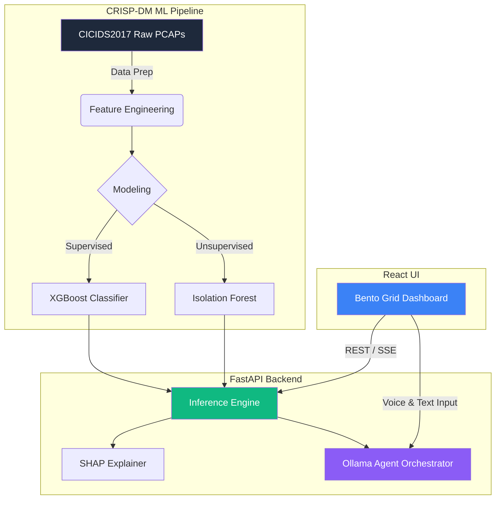

<div align="center">

# 🛡️ NIDS CICIDS2017: An AI-Assisted Network Intrusion Detection System

**A full-stack, research-oriented Cyber Data Science platform for SOC Analysts.**

[](https://python.org)
[](https://fastapi.tiangolo.com)
[](https://reactjs.org)
[](https://typescriptlang.org)
[](https://xgboost.readthedocs.io)
[](https://shap.readthedocs.io)
[](https://ollama.com)
[](https://docker.com)

*Bridging the gap between Machine Learning, Network Security, and Local Generative AI.*

</div>

---

## 📑 Abstract

Network Intrusion Detection Systems (NIDS) are critical components of modern Security Operations Centers (SOCs). However, traditional signature-based systems fail against zero-day attacks, and standard ML models often suffer from a lack of explainability and an inability to prioritize high-cost threats.

This project proposes an end-to-end, locally hosted platform that combines **supervised learning** (XGBoost) and **unsupervised anomaly detection** (Isolation Forest) on the CICIDS2017 dataset. To assist SOC analysts, the system integrates **Explainable AI (SHAP)** for root-cause analysis and a **Local AI Agent (Ollama)** for natural language investigation and remediation scripting.

---

## 🎯 1. Motivation & Scientific Context

### 1.1 The Problem with Standard ML Evaluation

In cybersecurity, **accuracy is a misleading metric**. A model that classifies 99% of traffic correctly but misses a slow brute-force attack is useless.

We frame this project under the paradigm of **Asymmetric Cost Evaluation**:

- **False Negative (FN):** Missing an attack (Data breach, catastrophic reputational damage).
- **False Positive (FP):** Blocking legitimate traffic (SOC fatigue, productivity loss).
- **Hypothesis:** We assume the cost of a False Negative is **10x** the cost of a False Positive. Our models are optimized and calibrated based on this asymmetric cost function.

### 1.2 The Need for Human-in-the-Loop AI

Deep Learning models are black boxes. In a SOC, an analyst will not block a network flow based solely on a "0.92" probability score. They need context. This project uses **SHAP** to explain *which specific features* (e.g., `SYN Flag Count`, `Flow Duration`) triggered the alert, and a **Local LLM** to translate these technical metrics into actionable threat intelligence.

---

## 🏗️ 2. System Architecture

The system is designed as a **Monorepo** with a decoupled Client-Server architecture, entirely containerized for reproducibility.



## 🛠️ 3. Technical Methodology & Stack

### 3.1 Machine Learning & Data Engineering

- Dataset: CICIDS2017 (Canadian Institute for Cybersecurity).
- Data Cleaning: Handling of NaN and inf (infinite) values inherent to network flow metrics (Flow Bytes/s).
- Class Imbalance: Mitigated via class_weight tuning and optimal threshold search.
- Models:
  - XGBoost: For known attacks (DDoS, PortScan).
  - Isolation Forest: For zero-day anomaly detection (detecting what deviates from the "normal" baseline).
- Explainability: shap.TreeExplainer is used to compute exact Shapley values for the deployed models.

### 3.2 AI Agent (Local LLM)

- Engine: Ollama (Mistral 7B or Llama 3).
- Role: The agent receives the SHAP explanations and the network flow metadata. It acts as a "Tier 1 SOC Analyst", explaining the threat in plain English and generating firewall rules (e.g., iptables or ufw commands).
- Privacy: 100% local inference. No telemetry or sensitive network data leaves the machine.

### 3.3 Software Engineering

- Backend: FastAPI (async endpoints, Pydantic validation, Server-Sent Events for LLM streaming).
- Frontend: React + Vite + TypeScript + Tailwind CSS (Bento Grid layout).
- CI/CD: GitHub Actions (Pytest, ESLint).
- Deployment: Docker Compose.

## 📂 4. Repository Structure

```text
nids-cicids2017/
├── ml/                     # Machine Learning Pipeline (CRISP-DM)
│   ├── notebooks/          # 01_EDA, 02_DataPrep, 03_Modeling, 04_Evaluation
│   ├── src/                # features.py, model.py, evaluation.py, explain.py
│   ├── data/               # raw/ and processed/ (git-ignored)
│   └── models/             # Serialized artifacts (.joblib) and metadata.json
├── backend/                # FastAPI Application
│   ├── app/
│   │   ├── api/            # Routes (predict, explain, agent)
│   │   ├── core/           # Settings and configurations
│   │   ├── ml/             # Model loading & inference logic
│   │   └── agent/          # Ollama integration & SOC prompts
│   └── tests/              # Pytest
├── frontend/               # React Application (Vite)
│   ├── src/
│   │   ├── components/     # BentoGrid, AlertTable, SHAPChart, AgentChat
│   │   └── hooks/          # API fetching and SSE streaming
│   └── package.json
├── doc/                    # Threat Model, Evaluation Report, Incident Log
├── docker-compose.yml      # Orchestrates Backend, Frontend, and Ollama
└── README.md
```

## 📊 5. Evaluation & Metrics

The performance of the ML pipeline is documented in doc/EVALUATION.md. We prioritize the following metrics:

- PR-AUC (Precision-Recall AUC): The most reliable metric for highly imbalanced datasets.
- Recall (Attacks): We aim for >95% to capture as many threats as possible.
- Asymmetric Cost: Minimizing (10 * FN) + (1 * FP).
- Calibration: Isotonic calibration ensures that a predicted probability of 0.8 actually means an 80% chance of being an attack.

## 🚀 6. Reproducibility & Installation

### Prerequisites

- Docker & Docker Compose
- Ollama (for the AI Agent)

### Quick Start (Docker)

```bash
# 1. Clone the repository
git clone https://github.com/ephremkadja01-coder/nids-cicids2017.git
cd nids-cicids2017

# 2. Pull the LLM model
ollama pull mistral

# 3. Launch the full stack
docker-compose up --build
```

### Local Development (For researchers)

```bash
# Backend
cd backend
python -m venv .venv
source .venv/bin/activate
pip install -r requirements.txt
uvicorn app.main:app --reload

# Frontend
cd frontend
npm install
npm run dev
```

## ⚠️ 7. Threat Model & Limitations

A rigorous system must define its boundaries:

- Zero-Day Blindness: The XGBoost model is bound by the CICIDS2017 dataset. It cannot detect novel attack vectors. The Isolation Forest mitigates this, but requires human validation due to a higher false-positive rate.
- Prompt Injection: The Ollama Agent processes network metadata (which could contain malicious strings). We implement strict prompt boundaries, but LLMs remain vulnerable to adversarial inputs.
- Model Drift: Network traffic patterns change. Continuous retraining is mandatory for production use.
- Ethical Use: This tool is designed as a detection and assistance system (NIDS), not an automated prevention system (IPS). Automated remediation scripts generated by the LLM must be reviewed by a human.

## 🤝 8. Contact & Acknowledgments

Author: Ephrem Kadja — ML Engineer | Cyber Data Science

- Portfolio
- LinkedIn

Dataset sourced from the Canadian Institute for Cybersecurity (UNB).